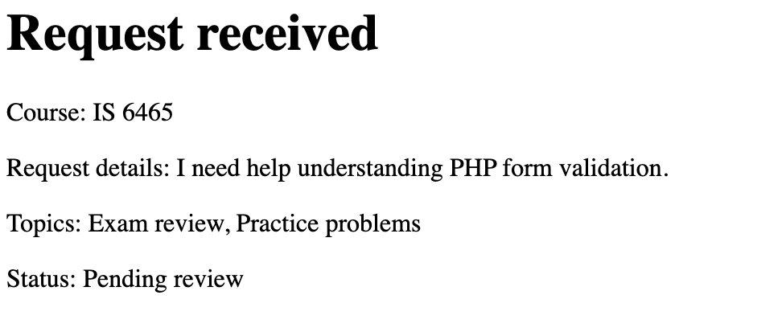

# Lab 4 Notes: Guided Application Walkthrough and Testing

## Part 1: Run the application

I ran the application in GitHub Codespaces with `php -S 0.0.0.0:8000` and opened `request-form.php`. I submitted a valid request for IS 6465 with the topics Exam review and Practice problems, an Afternoon time, a date of 11/10/2026, and the reason "I need help understanding PHP form validation."

After I submitted the form, the browser sent the data to `process-request.php` using POST. The server validated every field, and because there were no errors it displayed a "Request received" page showing the course, request details, topics, and "Status: Pending review." This confirmation page shows up as plain text without the navigation bar because `process-request.php` does not include the header, nav, or footer templates.

## Part 2: Trace the templates

**What content does header.php provide to every page?**
`header.php` provides the start of the HTML document, including the doctype, the `<head>` section with the charset and viewport meta tags, the Bootstrap CSS link, the `css/styles.css` link, and the page title "Peer Tutoring Hub." It also opens the `<body>` tag.

**What content does nav.php provide?**
`nav.php` provides the blue navigation bar with the "Peer Tutoring Hub" brand link and links to the Requests page and the Request a Session page.

**What content does footer.php provide?**
`footer.php` provides the footer with the "Peer Tutoring Hub" text, loads the Bootstrap JavaScript bundle, and closes the `</body>` and `</html>` tags.

**Why is require_once appropriate for these files?**
These files are required for the page to work, so `require` stops the page with an error if a file is missing instead of showing a broken page. The `_once` part makes sure each template is only included one time, which prevents duplicate HTML like two headers or two navigation bars.

**Where is the shared CSS file linked?**
The shared CSS file is linked in `includes/header.php` with `<link rel="stylesheet" href="css/styles.css">`, so every page that includes the header gets the same styles.

## Part 3: Observe the form controls

| Control | Purpose | Value type PHP receives |
|---|---|---|
| `reason` | A textarea where the student describes what they need help with. | A string (the text the user typed). |
| `topics[]` | Checkboxes that let the student pick one or more topics. The `[]` in the name tells PHP to collect all checked values together. | An array of strings, such as `["Exam review", "Practice problems"]`. If no boxes are checked, nothing is sent, and the code defaults it to an empty array. |
| `preferredtime` | Radio buttons that let the student pick only one time: Morning, Afternoon, or Evening. | A single string, such as `"Afternoon"`. |
| `preferreddate` | A date input where the student chooses the day they want the session. | A string in `YYYY-MM-DD` format, such as `"2026-11-10"`. |
| `form_name` | A hidden input that identifies which form was submitted, and the server checks it before accepting the request. | A string with the value `"tutoring_request"`. |

## Part 4: Test validation behavior

### Test 1: Valid request
- **Values entered:** Course IS 6465, topics Exam review and Practice problems, time Afternoon, date 11/10/2026, reason "I need help understanding PHP form validation."
- **Outcome:** The request was accepted.
- **Message displayed:** "Request received" followed by "Course: IS 6465," "Request details: I need help understanding PHP form validation.," "Topics: Exam review, Practice problems," and "Status: Pending review."
- **Business rule checked:** All the rules passed, which means the course and time were from the allowed lists, the reason was 10 to 500 characters, at least one valid topic was selected, the date was valid and not in the past, and the form name was correct.

### Test 2: Missing or invalid value
- **Values entered:** Course IS 6495, topic Study plan, time Morning, date 11/10/2026, reason "Help."
- **Outcome:** The request was rejected.
- **Message displayed:** "Request could not be submitted" with the error "Describe your request using 10 to 500 characters."
- **Business rule checked:** The reason must be between 10 and 500 characters long. The browser allowed "Help" because the field was not empty, but the server-side validation rejected it.

### Test 3: Past date
- **Values entered:** Course IS 6570, topic Exam review, time Evening, date 10/15/2026, reason "I need help reviewing for the midterm exam."
- **Outcome:** The request was rejected.
- **Message displayed:** "Request could not be submitted" with the error "Preferred date cannot be in the past."
- **Business rule checked:** The preferred date must be today or a future date, because a tutoring session cannot be scheduled for a day that has already passed.

## Part 5: Review testing and CRUD pages

### Validation test results
When I opened `tests/validation-tests.php`, all 10 test cases showed PASS:

- Valid time: PASS
- Missing time: PASS
- Altered value: PASS
- Multiple valid topics: PASS
- Missing topics: PASS
- Altered topic: PASS
- Minimum length: PASS
- Maximum length: PASS
- Too short: PASS
- Too long: PASS

### CRUD pages

I opened `requests.php`, which listed requests 12, 13, and 14, and clicked View on request 12. The details page showed the course IS 6465, the request details, the date 2026-10-22, the Morning time, the topics Exam review and Study plan, and a Pending status. From there, the Edit button opened an "Edit tutoring request" form filled in with sample data, and the Cancel request button opened a "Cancel tutoring request" page asking "Cancel request 12?" with Keep request and Yes, cancel request buttons.

| CRUD action | Page |
|---|---|
| Create | `request-form.php` (submitted to `process-request.php`) |
| Read one request | `request-details.php` |
| Read all requests | `requests.php` |
| Update | `edit-request.php` |
| Delete | `delete-request.php` |

**What query parameter appears in the request details URL?**
The query parameter is `request_id`. When I clicked View for request 12, the URL ended with `request-details.php?request_id=12`.

**Why is a GET query parameter appropriate for viewing one request?**
GET is appropriate because viewing a request only reads data and does not change anything on the server. Putting the `request_id` in the URL also means the page can be bookmarked, refreshed, or shared and it will still show the same request.

**Why should an actual update or delete later use POST rather than GET?**
Updates and deletes change data, so they should use POST so that simply visiting or refreshing a URL, or a browser or search engine following a link, cannot accidentally change or delete a request. POST also sends the data in the request body instead of the URL, so it does not show up in the browser history.
